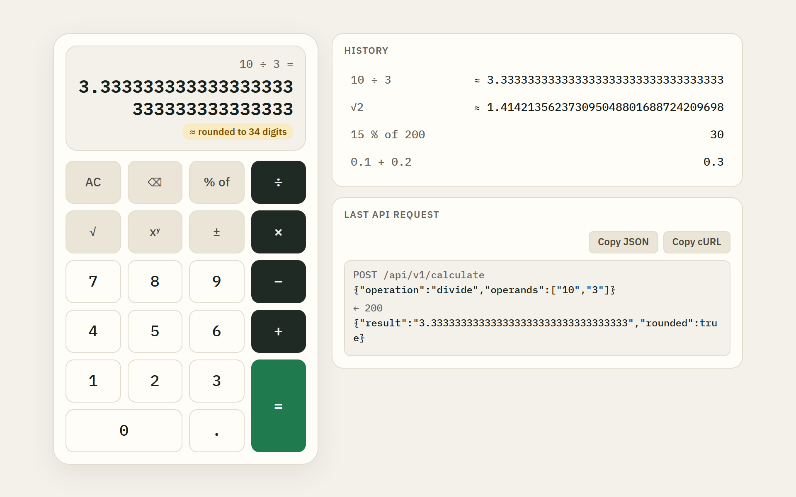
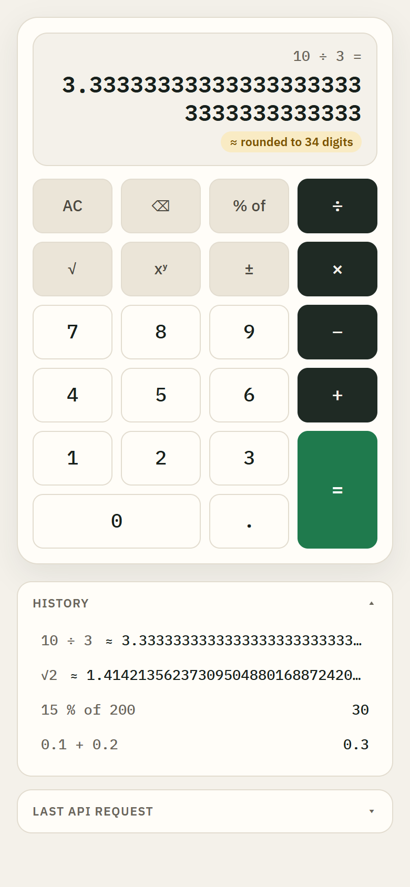

# Precision Calculator

A full-stack calculator built to payments-grade standards. A **Go** REST API does every calculation in IEEE 754 **decimal128** (34 significant digits, round-half-even) and never uses binary floating point. A **React + TypeScript** keypad UI keeps every number as a **string** end to end, so `0.1 + 0.2` is `0.3`, and anything that had to be rounded is labelled as such.

<p align="center">
  
  &nbsp;
  
</p>

---

## Quick start

Requires Docker.

```bash
docker compose up --build
```

Open **http://localhost:8080**. nginx serves the UI and proxies `/api` to the Go backend. The backend is not published to the host, and Compose waits for its healthcheck before starting the UI.

## Running locally without Docker

Prerequisites: **Go 1.27+** and **Node 22.22+ or 24.15+** (developed on Go 1.27 and Node 24; the test tooling — Vitest 5, jsdom 30 — needs those Node versions).

```bash
# terminal 1 — API on http://localhost:8081
cd backend
go run ./cmd/server
```

```bash
# terminal 2 — UI on http://localhost:5173 (Vite proxies /api to :8081)
cd frontend
npm install
npm run dev
```

## API reference

### `POST /api/v1/calculate`

Operands and results are **JSON strings**, never JSON numbers.

```json
{ "operation": "divide", "operands": ["10", "3"] }
```

```json
{ "result": "3.333333333333333333333333333333333", "rounded": true }
```

`rounded` is `true` when the exact result needed more than 34 significant digits and was rounded half-even.

| `operation` | Operands | Meaning | Operation-specific errors |
|---|---|---|---|
| `add` | 2 | a + b | |
| `subtract` | 2 | a − b | |
| `multiply` | 2 | a × b | |
| `divide` | 2 | a ÷ b | b = 0 → `DIVISION_BY_ZERO` |
| `power` | 2 | aᵇ; b must be a whole number with \|b\| ≤ 6000 | `NON_INTEGER_EXPONENT`; \|b\| > 6000 → `RESULT_OUT_OF_RANGE`; 0 to a negative power → `DIVISION_BY_ZERO`; 0⁰ = 1 |
| `sqrt` | 1 | √a | a < 0 → `NEGATIVE_SQUARE_ROOT` |
| `percent` | 2 | "a % of b" = a × b ÷ 100 | |

Any result outside the decimal128 range returns `RESULT_OUT_OF_RANGE`.

**Operand format:**
- Plain or scientific notation: `-12.5`, `1.5E+40`.
- At most 34 significant digits.
- Within the decimal128 range.
- Rejected: `null`, `""`, `+1`, `.5`, `5.`, `007`, `1,000`, `NaN`, `Infinity`.

**Result format:**
- Plain notation for magnitudes from 10⁻⁶ up to 34 integer digits; scientific notation beyond that (`1E+40`, `1E-7`).
- Trailing zeros are dropped.
- Any result can be sent back as an operand, which is what the UI does when you chain operations.

### `GET /healthz`

Returns `200 {"status":"ok"}`.

### Errors

Every error has the same shape and an HTTP status that means something:

```json
{ "error": { "code": "DIVISION_BY_ZERO", "message": "Cannot divide by zero." } }
```

| Status | `code` | When |
|---|---|---|
| 400 | `INVALID_JSON` | Malformed JSON, wrong types (for example a number instead of a string), unknown fields, trailing data |
| 400 | `UNKNOWN_OPERATION` | `operation` missing or unsupported (case-sensitive) |
| 400 | `INVALID_OPERAND_COUNT` | Wrong number of operands for the operation |
| 400 | `INVALID_NUMBER` | An operand is null, malformed, has more than 34 digits or is out of range. The message names its position |
| 404 | `NOT_FOUND` | Unknown path |
| 405 | `METHOD_NOT_ALLOWED` | Wrong method; the `Allow` header lists the right one |
| 413 | `PAYLOAD_TOO_LARGE` | Body larger than 1 KB |
| 422 | `DIVISION_BY_ZERO`, `NEGATIVE_SQUARE_ROOT`, `NON_INTEGER_EXPONENT`, `RESULT_OUT_OF_RANGE` | Well-formed request, but the maths has no answer |
| 500 | `INTERNAL_ERROR` | Unexpected failure. Never caused by input |

**400 means the request is malformed; 422 means it is well-formed but cannot be computed.**

### Examples

These run against the Docker stack. Swap `8080` for `8081` to call the backend you started with `go run`. The outputs below are real.

```bash
curl -s -X POST http://localhost:8080/api/v1/calculate \
  -H "Content-Type: application/json" \
  -d '{"operation":"divide","operands":["10","3"]}'
# 200 {"result":"3.333333333333333333333333333333333","rounded":true}

curl -s -X POST http://localhost:8080/api/v1/calculate \
  -H "Content-Type: application/json" \
  -d '{"operation":"add","operands":["0.1","0.2"]}'
# 200 {"result":"0.3","rounded":false}

curl -s -X POST http://localhost:8080/api/v1/calculate \
  -H "Content-Type: application/json" \
  -d '{"operation":"add","operands":[null,"2"]}'
# 400 {"error":{"code":"INVALID_NUMBER","message":"Operand 1 is not a valid number."}}

head -c 2000 /dev/zero | tr '\0' ' ' | curl -s -X POST http://localhost:8080/api/v1/calculate \
  -H "Content-Type: application/json" --data-binary @-
# 413 {"error":{"code":"PAYLOAD_TOO_LARGE","message":"Request body must not exceed 1 KB."}}

curl -s -X POST http://localhost:8080/api/v1/calculate \
  -H "Content-Type: application/json" \
  -d '{"operation":"divide","operands":["1","0"]}'
# 422 {"error":{"code":"DIVISION_BY_ZERO","message":"Cannot divide by zero."}}

curl -s -X POST http://localhost:8080/api/v1/calculate \
  -H "Content-Type: application/json" \
  -d '{"operation":"power","operands":["2","6001"]}'
# 422 {"error":{"code":"RESULT_OUT_OF_RANGE","message":"The exponent must be between -6000 and 6000."}}
```

The commands target bash or zsh. On Windows, use Git Bash, or `curl.exe` in PowerShell with escaped quotes. The UI's inspector has a **Copy cURL** button that produces a ready-to-run command for the last request.

## Design decisions

**Decimal128 through `cockroachdb/apd`.** Floats were never an option: even `float64` gives `0.1 + 0.2 = 0.30000000000000004`. I chose `apd` over the more common `shopspring/decimal` because it implements the General Decimal Arithmetic spec. That gives it `Sqrt` and `Pow` under a configurable context, and its condition flags (`Inexact`, `Overflow`, `Underflow`) report rounding and range problems without custom code. One context (`Precision 34`, `RoundHalfEven`, exponents −6143…+6144) is shared read-only by every request.

**Numbers are strings on the wire.** A JSON number would be parsed into an IEEE-754 double by the browser, losing the precision the backend protects. Operands and results are strings both ways. The frontend never calls `Number()` on them: the display, history and chaining all work on the strings.

**34 digits, half-even, and a `rounded` flag.** Inexact results (`10 ÷ 3`, `√2`) are rounded the way accounting systems do it, so rounding doesn't drift upwards. The response says when that happened, and the UI shows "≈ rounded to 34 digits". Rounding is never silent.

**Notation by magnitude, and a round-trip guarantee.** Results use plain notation unless they are tiny or huge. Every result the API returns is accepted back as an operand, including subnormals, and a test asserts it. That is what lets the keypad chain from a result such as `1.5E+40`.

**Explicit abuse limits.**
- Arbitrary-precision decimals don't overflow on their own, so the API enforces explicit limits.
- Request bodies over 1 KB are rejected (413).
- Operands are limited to 34 digits.
- Results must fit in decimal128.
- Power exponents above 6000 in magnitude are rejected **before** any computation, so `10^999999999` costs nothing. The trade-off, accepted on purpose: a trivially safe input like `1^7000` is rejected too.

**Layers, without ceremony.**
- `internal/calculator` is a pure domain: strings in, strings out, no HTTP.
- `internal/httpapi` decodes strictly (`DisallowUnknownFields`, no trailing data), maps domain error codes to statuses, and adds request logging (`log/slog`) and panic recovery.
- `cmd/server` handles wiring, server timeouts, graceful shutdown, and a `healthcheck` mode.

There is deliberately no service or repository layer: there is no state to manage or persist, and empty layers would be noise.

**A simple error shape instead of RFC 9457.** Errors are a small `{code, message}` object. The codes are stable and machine-readable; the messages are safe to show users and the UI displays them directly. A production API would adopt **RFC 9457 Problem Details** (`application/problem+json`). It was left out here to keep the contract minimal.

**A keypad that can't send garbage.**
- The UI validates as you type: only digits, one decimal point, a sign key, and at most 34 digits. The physical keyboard goes through the same filter, so the user can't type something the API would reject.
- Operations evaluate **left to right without precedence**, like a basic calculator. Each step is one API call.
- The "% of" key makes percentage unambiguous ("15 % of 200 = 30").
- Pressing Enter on a focused key evaluates once instead of re-pressing it. Enter on any other button activates that button.

**One theme, "Ledger".**
- Paper tones, a single green for "money", and IBM Plex Mono with tabular figures for every number.
- Fonts are self-hosted through `@fontsource`; nothing loads from a CDN.
- Long results wrap instead of being truncated. History rows truncate and expand on click.
- On phones, the panels collapse under the keypad.

**Containers.**
- The backend runs on `distroless/static` as non-root. It has no shell, so the binary has its own `healthcheck` mode for Compose.
- The UI runs on unprivileged nginx with basic security headers.
- The browser only ever talks to one origin, so CORS is not needed.

## Testing & coverage

Everything was built test-first: each behaviour got a failing test before the code that makes it pass.

```bash
cd backend && go test ./... -cover      # Go: table-driven unit + httptest tests
cd frontend && npm test                 # Vitest + React Testing Library
cd frontend && npm run coverage         # fails below the 85% thresholds
```

| Layer | Statements | Notes |
|---|---|---|
| Backend total | **90.9 %** | calculator 92.0 %, httpapi 92.4 %, cmd/server 87.0 % |
| Frontend total | **97.6 %** | branches 96.4 %, functions 97.8 %, lines 99.3 %; 101 tests |

HTML reports are committed so they can be opened without running anything: [`docs/coverage/backend.html`](docs/coverage/backend.html) and [`docs/coverage/frontend/index.html`](docs/coverage/frontend/index.html).

What the suites pin down:
- **Arithmetic:** every operation; the reference values from the spec (`0.1 + 0.2`, `10 ÷ 3`, `2 ÷ 3`, `√2`); round-half-even ties at the 35th digit.
- **Failures and limits:** division by zero, `√-4`, fractional and oversized exponents, overflow and underflow, the operand grammar (34 vs 35 digits), the round-trip guarantee.
- **HTTP:** every status code with its exact JSON body, the 1024/1025-byte boundary, JSON 404/405 responses.
- **Keypad:** chaining, operator replacement, input lock while a request is in flight, error reset.
- **UI:** keyboard input, the focused-key Enter case, Copy JSON/cURL including clipboard failure, and a request timeout.

[GitHub Actions](.github/workflows/ci.yml) runs `go vet`, the Go tests with the race detector and a 90 % gate, oxlint, type-checking, the frontend coverage gate, and `docker compose build` on every push.

## Project structure

```
backend/
  cmd/server/            entrypoint, graceful shutdown, healthcheck mode
  internal/calculator/   decimal128 domain: parsing, operations, formatting, errors
  internal/httpapi/      routes, strict JSON decoding, error mapping, middleware
  Dockerfile             golang:1.27 → distroless, non-root
frontend/
  src/calculator/        entry rules, keypad reducer (pure), keyboard map, useCalculator hook
  src/api/               typed fetch client, cURL builder
  src/components/        Display, Keypad, History, Inspector, Section
  nginx.conf, Dockerfile node:24 → unprivileged nginx
docs/
  superpowers/specs/     approved design spec
  superpowers/plans/     TDD implementation plan
  design/                brainstorming mockups (process history)
  coverage/              committed coverage reports
  screenshots/
  prompts.md             every prompt used, verbatim (Spanish) with English translation
docker-compose.yml
.github/workflows/ci.yml
```

## How this was built

I built this with **Claude Code** and the **[Superpowers](https://github.com/obra/superpowers)** skills, which enforce a design → plan → TDD workflow:

1. **Brainstorming** (`superpowers:brainstorming`). A conversation that worked out *why* before *what*: who the reviewer is, what "fintech-grade" should mean here, and the anti-goal of over-engineering. Its visual companion produced browser mockups to choose the layout (three options) and the theme (three options). They are kept in [`docs/design/`](docs/design/).
2. **Written spec plus an independent builder check.** The decisions went into a [design spec](docs/superpowers/specs/2026-10-28-fullstack-calculator-design.md). Before approval, a fresh subagent read it as if it had to build from it alone. It found a contradiction in the result-formatting rule, which was fixed before any code existed.
3. **Implementation plan** (`superpowers:writing-plans`). A [15-task plan](docs/superpowers/plans/2026-10-28-fullstack-calculator.md) with exact interfaces, test cases and expected outputs per task. It includes a "Review Focus" list of failure modes no test would naturally hit (Enter on a focused key, chaining from scientific notation, a hung backend, the 1 KB boundary).
4. **Execution** (`superpowers:executing-plans` + `superpowers:test-driven-development`). Every task followed red → green → commit. A ledger recorded each decision that deviated from the plan, for example moving `main()` logic into a testable `run()` when backend coverage came out at 80.5 %.
5. **Review.** A fresh reviewer checked the whole branch against the spec and plan before merge.

Every prompt I wrote is in [`docs/prompts.md`](docs/prompts.md), verbatim in the original Spanish with English translations.

## Assumptions & future work

- **Single-shot operations.** The API evaluates one operation per request. An expression endpoint with precedence (`2 + 3 × 4`) would be a natural next step.
- **RFC 9457** Problem Details for errors in a production API.
- **Rate limiting** per client, on top of the per-request limits.
- **Persisted history** (currently per session, in memory, capped at 50 entries).
- A dark theme, built from the same design tokens.
